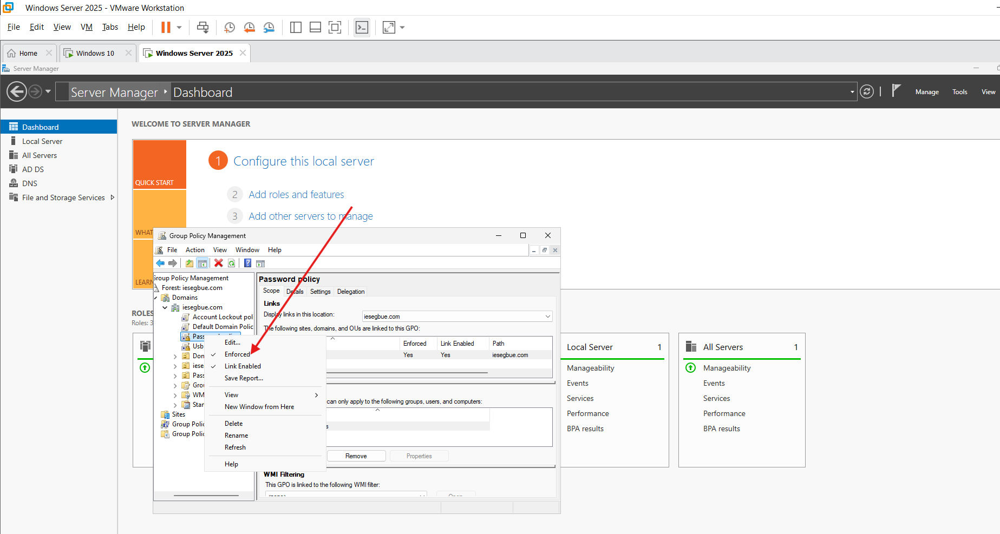

# Active Directory Identity & Access Management Lab

> A hands-on enterprise Active Directory lab demonstrating identity lifecycle management, role-based access control, Group Policy security, and Windows administration through PowerShell.

<p align="center">
  <strong>Windows Server 2025</strong> • <strong>Active Directory Domain Services</strong> • <strong>PowerShell</strong> • <strong>Group Policy</strong>
</p>

---

##  Project Overview

This lab demonstartes common identity and access management tasks found in an enterprise Windows environment. It focuses on administering users and computers, organizing Active Directory objects, automating onboarding, and applying security policies that reduce unauthorized access.

The project documents the complete environment through screenshots and recorded walkthroughs, making it useful as:

- A practical Active Directory administration portfolio project
- A learning resource for AD and PowerShell fundamentals
- A demonstration of IAM, RBAC, and endpoint security concepts
- A repeatable lab for identity lifecycle and Group Policy testing

##  Lab Goals

- Build and administer an Active Directory domain
- Organize users and resources using OUs and security groups
- Apply role-based access control principles
- Automate repetitive administrative tasks with PowerShell
- Enforce account lockout and password policies
- Control removable media through Group Policy
- Join and manage Windows computers in the domain
- Demonstrate secure account lifecycle workflows

##  Lab Architecture

| Component | Purpose |
|---|---|
| Windows Server 2025 | Domain controller and administrative server |
| Active Directory Domain Services | Provides centralized identity, authentication, and directory services |
| Active Directory Users and Computers | GUI administration of users, groups, computers, and OUs |
| Group Policy Management | Centralized configuration and security policy enforcement |
| Windows 10 or 11 clients | Domain members used to validate policy and access behavior |
| PowerShell | Automation of OUs, users, groups, computers, and account operations |
| VMware Workstation | Virtualization platform for the lab environment |

##  Skills Demonstrated

### Identity Administration

- Created organizational units for departments and locations
- Organized users into business-aligned OUs
- Assigned users to departmental security groups
- Managed user properties and Active Directory objects
- Created and administered domain computer accounts
- Documented domain join and onboarding workflows

### Account Lifecycle Management

- Onboarded users with PowerShell
- Managed initial credentials and password requirements
- Reset user passwords
- Disabled user accounts when access is no longer required
- Verified account membership and status

### Role-Based Access Control

- Used security groups to represent job roles
- Organized access by departments such as HR, IT, and Sales
- Applied least-privilege principles through centralized group membership
- Used groups as the control point for permissions and future access assignments

### Group Policy and Endpoint Security

- Configured an account lockout policy
- Configured password policy settings
- Used Group Policy to apply security settings consistently
- Demonstrated policy updating and enforcement
- Implemented removable USB storage restrictions
- Reviewed policy behavior on domain members

### PowerShell Automation

- Created OUs through PowerShell
- Automated bulk user creation
- Populated users and departmental groups
- Joined computers to the Active Directory domain
- Used AD PowerShell modules for repeatable administration

## Repository Structure

```text
.
├── README.md
├── images/
│   ├── Ad users and computers.png
│   ├── Account lockout policy.png
│   ├── Password reset.png
│   ├── Disabling account.png
│   ├── Onboarding AdUsers.png
│   ├── Joining or onboarding computers to the Active Directory.png
│   ├── password policy.png
│   ├── Group policy update.png
│   ├── enforce.png
│   ├── usb policy.png
│   ├── USb Restriction.png
│   └── local account.png
└── videos/
    ├── Creating OU in active directory.mp4
    ├── Joining Computers to the Active Directory powershell.mp4
    └── Onboarding AdUsers with powershell automation.mp4
```

## Evidence Gallery

### Organizational Structure and User Administration

| Active Directory Users and Computers | Onboarding with PowerShell |
|---|---|
| [](images/Ad%20users%20and%20computers.png) | [](images/Onboarding%20AdUsers.png) |

### Computer and Account Management

| Domain Join | Local Account | Password Reset | Account Disable |
|---|---|---|---|
| [](images/Joining%20or%20onboarding%20computers%20to%20the%20Active%20Directory.png) | [](images/local%20account.png) | [](images/Password%20reset.png) | [](images/Disabling%20account.png) |

### Security and Group Policy

| Account Lockout Policy | Password Policy | Policy Update |
|---|---|---|
| [](images/Account%20lockout%20policy.png) | [](images/password%20policy.png) | [](images/Group%20policy%20update.png) |

| USB Restriction | Policy Enforcement |
|---|---|
| [](images/USb%20Restriction.png) | [](images/enforce.png) |

Additional removable-storage documentation is available in [USB policy](images/usb%20policy.png).

##  Video Demonstrations

- [Creating an organizational unit in Active Directory](videos/Creating%20OU%20in%20active%20directory.mp4)
- [Joining computers to the Active Directory domain with PowerShell](videos/Joining%20Computers%20to%20the%20Active%20Directory%20powershell.mp4)
- [Onboarding Active Directory users with PowerShell automation](videos/Onboarding%20AdUsers%20with%20powershell%20automation.mp4)

##  Example PowerShell Workflows

The examples below use this Active Directory hierarchy:

```text
iesegbue.com
└── iesegbue llc
    ├── london
    │   ├── IT
    │   ├── HR
    │   └── Sales
    ├── manchester
    │   ├── IT
    │   ├── HR
    │   └── Sales
    └── preston
        ├── IT
        ├── HR
        └── Sales
```

The domain distinguished name is `DC=iesegbue,DC=com`.

### Create the hierarchy and department OUs

```powershell
$DomainDN = "DC=iesegbue,DC=com"
$CompanyOU = "OU=iesegbue llc,$DomainDN"
$Locations = @("london", "manchester", "preston")
$Departments = @("IT", "HR", "Sales")

if (-not (Get-ADOrganizationalUnit -Filter "DistinguishedName -eq '$CompanyOU'" -ErrorAction SilentlyContinue)) {
    New-ADOrganizationalUnit -Name "iesegbue llc" -Path $DomainDN
}

foreach ($Location in $Locations) {
    $LocationDN = "OU=$Location,$CompanyOU"

    if (-not (Get-ADOrganizationalUnit -Filter "DistinguishedName -eq '$LocationDN'" -ErrorAction SilentlyContinue)) {
        New-ADOrganizationalUnit -Name $Location -Path $CompanyOU
    }

    foreach ($Department in $Departments) {
        $DepartmentDN = "OU=$Department,$LocationDN"

        if (-not (Get-ADOrganizationalUnit -Filter "DistinguishedName -eq '$DepartmentDN'" -ErrorAction SilentlyContinue)) {
            New-ADOrganizationalUnit -Name $Department -Path $LocationDN
        }
    }
}
```

### Create location-based department security groups

```powershell
$CompanyOU = "OU=iesegbue llc,DC=iesegbue,DC=com"

foreach ($Location in @("london", "manchester", "preston")) {
    $LocationDN = "OU=$Location,$CompanyOU"

    foreach ($Department in @("IT", "HR", "Sales")) {
        $DepartmentOU = "OU=$Department,$LocationDN"
        $GroupName = "$Location-$Department"

        if (-not (Get-ADGroup -Filter "Name -eq '$GroupName'" -ErrorAction SilentlyContinue)) {
            New-ADGroup `
              -Name $GroupName `
              -SamAccountName $GroupName `
              -GroupScope Global `
              -GroupCategory Security `
              -Path $DepartmentOU
        }
    }
}
```

### Join a computer to the domain

```powershell
Add-Computer `
  -DomainName "iesegbue.com" `
  -Credential (Get-Credential) `
  -Restart
```


### Suggested workflow

1. Create a Windows Server 2025 virtual machine.
2. Configure a static IP address and host name.
3. Install and promote Active Directory Domain Services.
4. Configure DNS for the Active Directory domain.
5. Create organizational units and role-based security groups.
6. Create test users through the GUI and PowerShell.
7. Configure password and account lockout policies.
8. Configure removable media restrictions.
9. Create a Windows 10/11 client VM.
10. Join the client to the domain.
11. Sign in with a test user and validate policies and access.
12. Force policy refresh with `gpupdate /force` and inspect results.


## Security and Operational Practices

This lab uses Active Directory features that can map directly to real enterprise controls:

- **Least privilege:** Limit administrative rights and assign access through role groups
- **Group-based access:** Manage access by group membership rather than individual permissions
- **Credential hygiene:** Use temporary passwords and require password changes
- **Account lifecycle:** Disable accounts promptly and perform periodic access reviews
- **Centralized policy:** Use Group Policy for consistent password, lockout, and endpoint controls
- **Auditability:** Review AD and security events for account and policy activity
- **Change discipline:** Test policy changes in a controlled OU before broader deployment

##  Portfolio Takeaways

- Demonstrated hands-on administration of Active Directory identities and computers
- Applied IAM concepts to organizational structure and role-based groups
- Combined GUI and PowerShell workflows for domain administration
- Implemented account security, lockout, password, and USB controls
- Built visual and recorded evidence of complete administrative workflows
